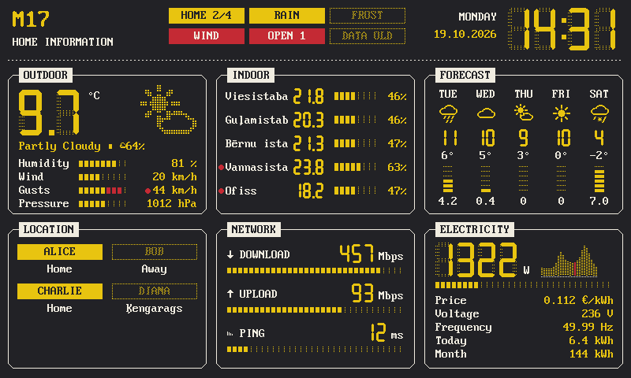
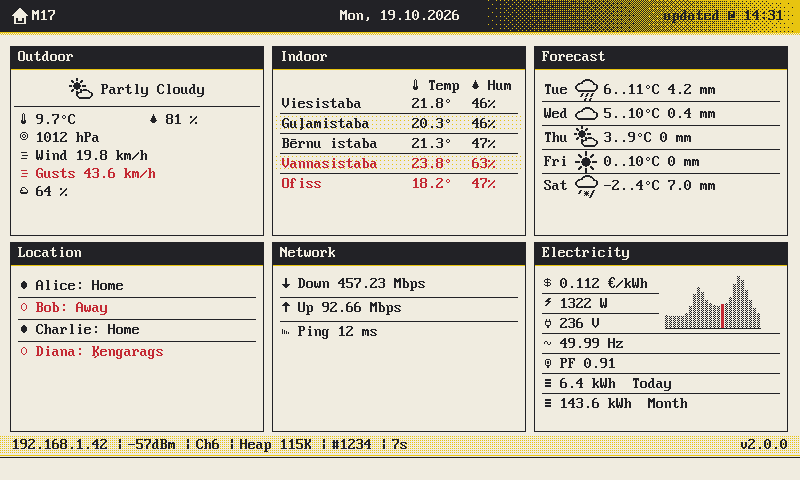
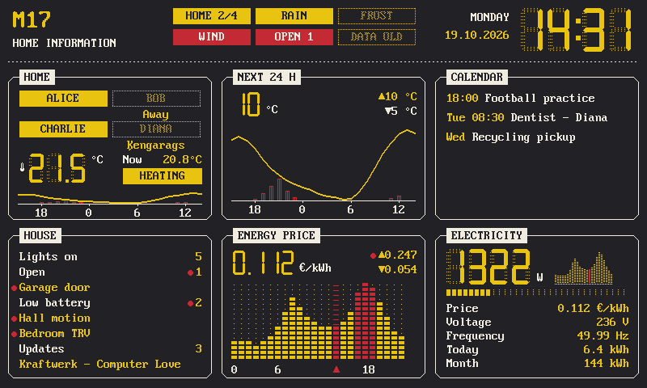
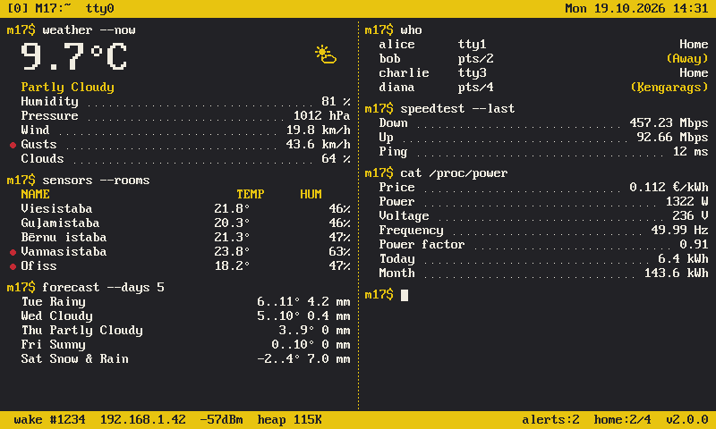
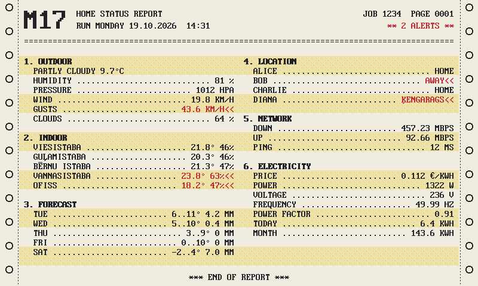
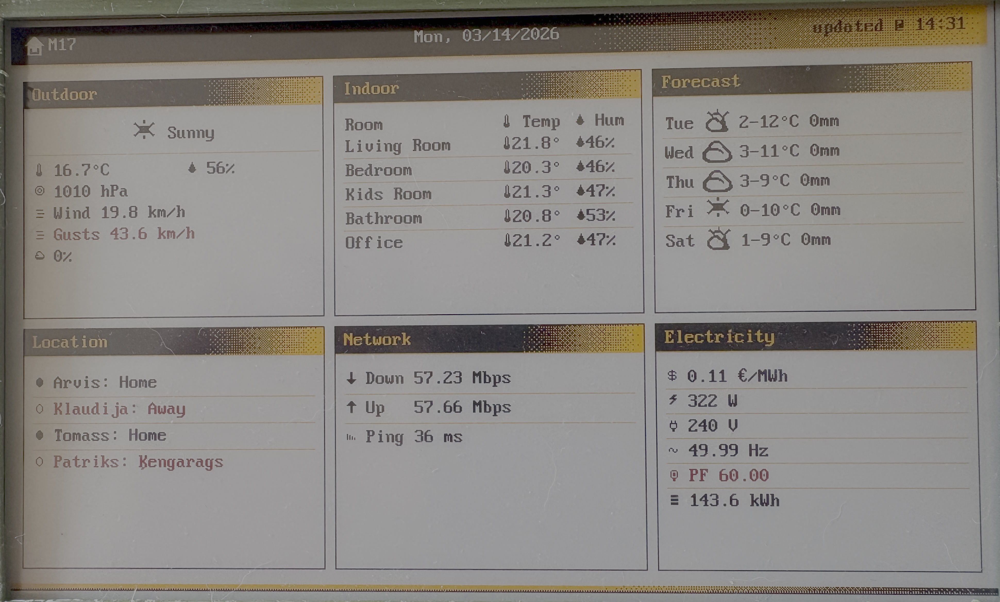

# M17 E-Paper Dashboard

ESP32 home information display on a 7.5" four-colour e-paper panel (800×480,
black/white/yellow/red), fed by Home Assistant. Four themes, a live web
dashboard, a full web admin panel, OTA updates, and deep-sleep battery
operation.

| VFD (fluorescent) | Classic (default) |
|---|---|
|  |  |
| **VFD with home, hourly, calendar, house, prices** | **Terminal** |
|  |  |
| **Line printer** | **On the panel (v0.6 classic)** |
|  |  |

Renders are produced by the host preview tool from sample data — exactly the
four-colour framebuffer the panel receives.

- **Themes**: *Classic* (default), *VFD* — an 80s hi-fi fluorescent display
  with 7-segment numerals, segmented meters and a spectrum-analyser price
  chart — *Terminal* (split-pane Unix session) and *Line Printer* (fanfold
  report with red-ribbon alerts).
- **14 widgets**, freely mapped to six slots: home overview (people and
  their locations, thermostat, daily temperature mini chart), outdoor, indoor rooms, 5-day
  forecast, 24 h hourly curve, people, network, electricity, hourly energy
  prices, house status (lights, open doors/windows, low batteries, updates,
  media), calendar, extra sensors, agenda, system.
- **Two ways to get data**: *pull* (the device asks Home Assistant — one
  template call, zero HA configuration, auto-discovers people, weather,
  calendars and house status) or *push* (HA posts JSON; the original payload
  still works).
- **Admin panel** in the browser: theme + live panel preview, slot mapping,
  Home Assistant connection test and entity search, thresholds, Wi-Fi scan,
  update interval and quiet hours, login, OTA firmware upload, config
  backup/restore, logs.
- English and Latvian (full diacritics), easy to add more languages.

## Hardware

| Part | Notes |
|---|---|
| ESP32 dev board (ESP32-D0WD, 4 MB flash) | PSRAM not required |
| GoodDisplay **GDEM075F52** 7.5" 4-colour e-paper + adapter | JD79665AA controller |

| Panel | ESP32 GPIO |
|---|---|
| SCK / CLK | 18 |
| MOSI / DIN | 23 |
| CS | 27 |
| DC | 14 |
| RST | 12 |
| BUSY | 13 |

Other panels can be added behind `include/display/epd_driver.h`.

## Quick start

1. Install [PlatformIO](https://platformio.org/) (CLI or VS Code).
2. Optional: create `.env` with first-boot defaults so the device joins your
   Wi-Fi straight away (otherwise configure it via its setup access point):
   ```bash
   SSID=your_wifi
   PASSWORD=your_password
   LANGUAGE=EN          # EN or LV
   DATE_FORMAT=DD.MM.YYYY
   # HA_URL=http://homeassistant.local:8123
   # HA_TOKEN=long-lived-access-token
   ```
3. Build and flash:
   ```bash
   pio run -t upload
   pio device monitor
   ```
4. Open the IP shown in the serial log (or `http://m17-epaper.local` on the
   same network) and go to **Admin**.

Without Wi-Fi settings — or after three failed connections — the device opens
an access point `M17-Setup-XXXX` and shows the steps on the e-paper; joining it
opens the admin panel automatically.

Later updates can be installed from **Admin → System → Firmware update**
(`.pio/build/esp32dev/firmware.bin`).

## Home Assistant

### Pull mode (recommended)

1. In HA: *Profile → Security → Long-lived access tokens → Create token*.
2. Device admin → **Data source**: choose *Pull*, enter the HA URL and token,
   press *Test connection*, *Save*.

Press **Pull from Home Assistant now** (Status tab) or the board's **BOOT**
button any time for an immediate update — this also works in push mode once a
URL and token are saved, and the button wakes a sleeping device.

That's it: with auto-discovery the device shows your weather entity, all
`person.*`, calendar events and house status. Map rooms, network, energy and
extra sensors in the same tab (entity fields autocomplete from HA), and use
*Test mapping* to see exactly what HA returns. Weather forecasts need HA
2024.8 or newer.

### Push mode

HA sends the data to `http://<device>/update`. Two options:

- **Existing setups** keep working unchanged — the original payload
  (`homeassistant/legacy_v1_example.yaml`) is still accepted.
- **Full data**: copy [`homeassistant/m17_epaper.yaml`](homeassistant/m17_epaper.yaml)
  into your HA `packages/` folder, edit the device IP and entity ids. It
  includes a helper to change the update interval from HA.

Payload reference and the complete API: [TECHNICAL.md](TECHNICAL.md).

## Power and update frequency

*Admin → Network & power*:

- **Always on** (default): the device stays awake; pull mode refreshes every
  *N* minutes, push mode redraws whenever HA sends data.
- **Battery / deep sleep**: wakes every *N* minutes (1–1440), aligned to the
  clock, draws and sleeps. After reset it stays awake 5 minutes for the
  admin panel; *Maintenance* keeps it awake for up to an hour.
- **Quiet hours**: no refreshes in a nightly window (e.g. 00–06).
- **Refresh waveform**: *Quality* (~22 s full colour) or *Fast* (~12 s,
  slightly less saturated). Unchanged frames are not redrawn at all.

E-paper keeps the image without power; a refresh is the only expensive
operation, so fewer, smarter refreshes mean longer battery life.

## Security

The admin panel is open until you set a username and password under
**Admin → Security**; afterwards it uses HTTP Basic auth. Tokens and
passwords are never returned by the API. Optionally require a push token for
`/update`. Keep the device on a trusted network — plain HTTP is used.

## Development

```bash
pio test -e native                           # 80 unit tests, runs on your computer
pio run -e preview && .pio/build/preview/program   # renders all themes to preview/*.bmp
python3 tools/ha_template_check.py           # checks the HA templates (needs jinja2, pyyaml)
python3 tools/gen_icons.py                   # regenerates the weather icons
```

Architecture, rendering pipeline, display driver, payload/config formats and
API: **[TECHNICAL.md](TECHNICAL.md)**.

## License

GPL-3.0 — see [LICENSE](LICENSE).
